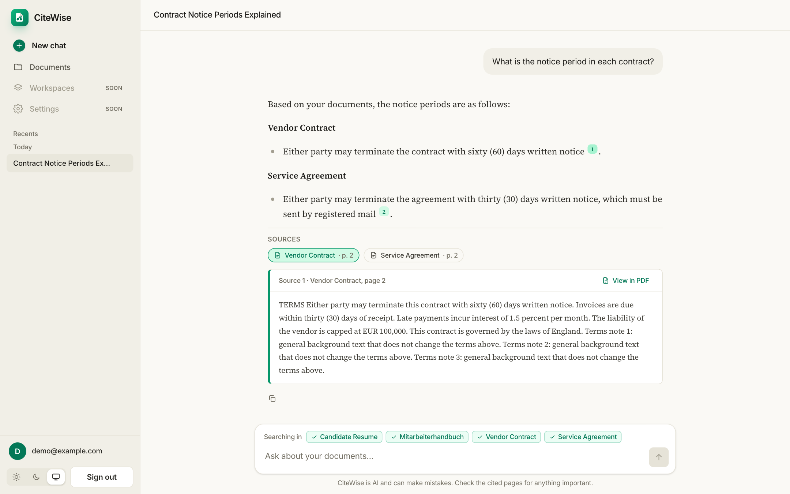
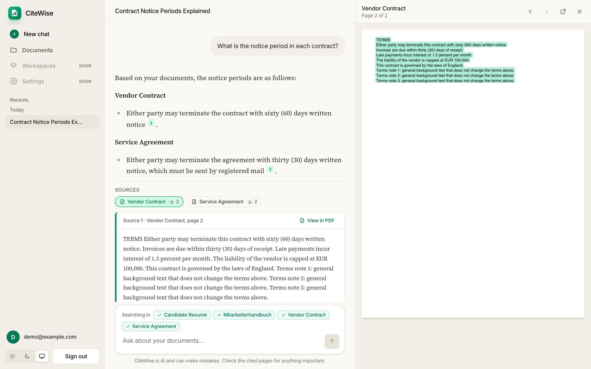
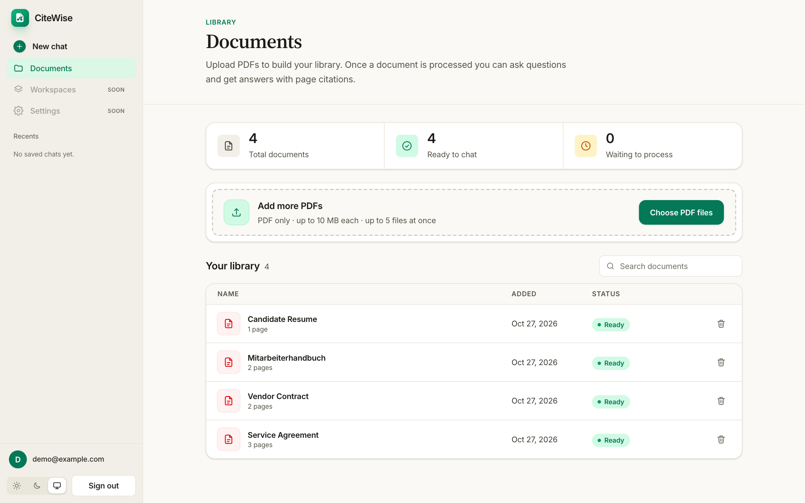
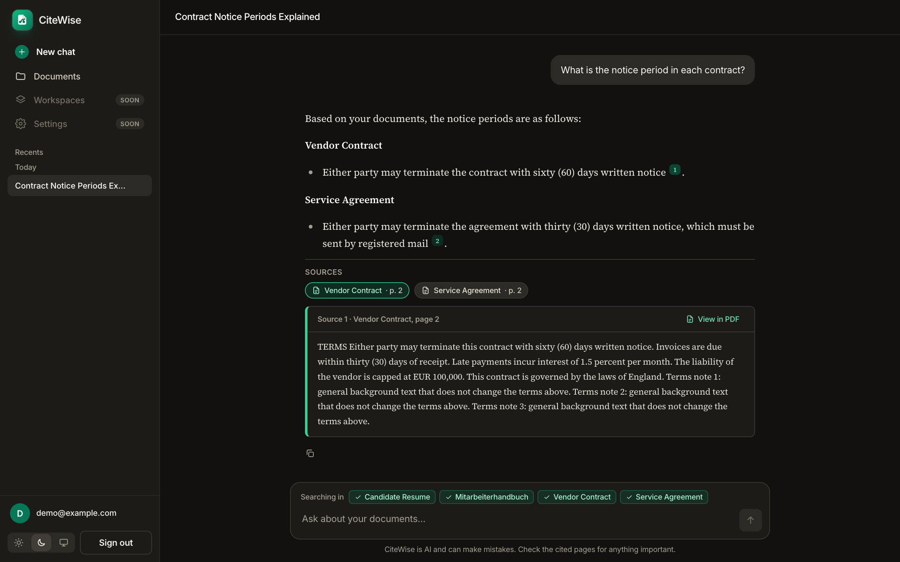
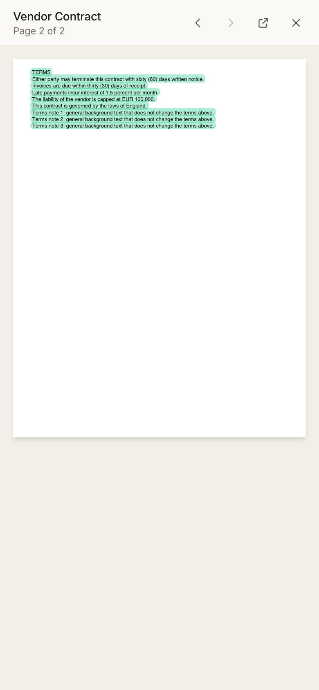
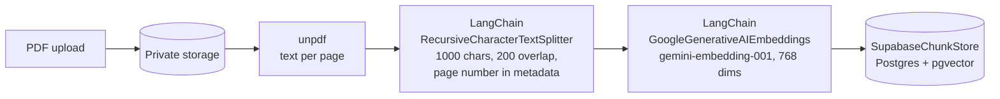
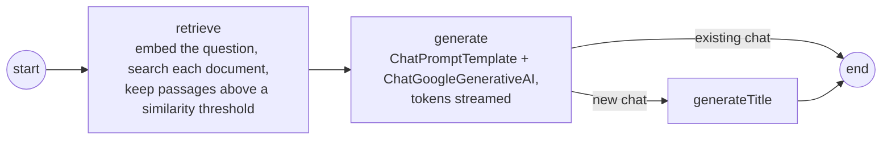

<div align="center">

# CiteWise

**Chat with your documents. Every answer cites its page.**

Upload PDFs, ask questions in English or German, and jump straight to the passage behind every answer.


</div>

---

**Live demo: [citewise-rouge.vercel.app](https://citewise-rouge.vercel.app)**

## Overview

CiteWise is a document-research app built around **verifiable answers**. Instead of
returning a block of text you have to trust, it will show the exact page of the exact
document each answer came from, so you can check it in one click.

> **Status: early development.** Authentication, the database schema, the dashboard,
> PDF upload, PDF processing, chat with page citations, saved chat history and a PDF viewer
> that opens at the cited page with the passage highlighted are done. Workspaces, an
> evaluation set and deployment are next. See the [roadmap](#roadmap) for what is built and what is planned.

## Screenshots

<p align="center">
  
</p>

<table>
  <tr>
    <td width="50%"><br><sub><b>View in PDF</b> opens the cited page with the passage highlighted.</sub></td>
    <td width="50%"><br><sub>The document library.</sub></td>
  </tr>
  <tr>
    <td width="50%"><br><sub>Dark mode.</sub></td>
    <td width="50%" align="center"><br><sub>The viewer on a phone.</sub></td>
  </tr>
</table>

The screenshots use made-up documents.

## What works today

| Area | Status | Details |
| --- | --- | --- |
| Sign up / sign in / sign out | Done | Email and password through Supabase Auth |
| Route protection | Done | Logged-out visitors are redirected to `/login` |
| Database schema | Done | Documents, chunks with page numbers and embeddings, chats, messages, workspaces |
| Row Level Security | Done | Every table is locked to its owner |
| Private file storage | Done | A private `documents` bucket, PDF only, 10 MB limit, per-user folders |
| Vector search function | Done | `match_chunks()` finds the closest passages by meaning |
| PDF upload | Done | Drag and drop or file picker, PDF only, up to 10 MB each, up to 5 at once, straight to private storage |
| PDF processing | Done | Text extracted page by page, split into overlapping chunks, embedded with Gemini (768 dimensions) and saved with page numbers. Status moves Uploaded, Processing, Ready or Failed, with a retry button |
| Chat with page citations | Done | Streamed answers from a Gemini chat model, grounded only in your documents (choose which documents to search; with several, answers name each document and keep their facts separate), with `[n]` citation badges and expandable source passages. Says "I couldn't find that in your documents" instead of guessing. Works across English and German |
| PDF viewer with highlighted citations | Done | "View in PDF" on any cited passage opens the document beside the chat at the exact page, with the passage highlighted. Page controls, open in a new tab, full screen on phones. The PDF is fetched from private storage and drawn in the browser with PDF.js |
| Usage limits | Done | Per-user caps on questions and processed documents, with friendly messages, to protect the shared AI quota |
| Saved chat history | Done | Every chat is saved with its sources and opens at its own address (`/chat/<id>`), with a short AI-written title. Recent chats are listed in the sidebar by date, with delete; follow-up questions use the saved conversation |
| Semantic search | Verified | `match_chunks()` returns the right page for questions in English and German |
| Document library | Done | List with status badges, summary counts, search by name and delete |
| Dashboard layout | Done | Sidebar navigation, page header, responsive top bar on phones |
| Light, dark and system themes | Done | Remembered per browser, applied before first paint so there is no flash |
| Login UI | Done | Responsive, password-strength hint |

### What you can do right now

1. Open the app and **create an account** on the sign-up tab.
2. **Sign in** and land on your document library.
3. **Upload PDFs** and see them appear in the list with an "Uploaded" status.
4. **Search** your library by name, and **delete** documents you no longer need.
5. Switch between **light, dark and system** themes from the sidebar.
6. **Sign out**.

Each upload is processed automatically: you can watch it go from Uploaded to
Processing to Ready, with a page count. Failed documents (for example scanned,
image-only PDFs) show a clear reason and a retry button. Open **Chat** to ask
questions about all your ready documents, or just one, and see which pages each
answer came from. Chats are saved automatically, so you can leave and come back to them
from the **Recent chats** list.

## Planned features

**Phase 1: core**
- ~~Upload PDFs~~ (done) and ask questions about them
- Streamed answers
- Source passages shown with each answer

**Phase 2: what sets it apart**
- Clickable page citations that open the PDF at the right page
- Saved chat history with a sidebar of past chats
- Workspaces that group documents, such as "Uni notes" or "Contracts"
- English and German, including cross-language questions
- Honest answers: "not found in your documents" instead of guessing
- An automatic summary and suggested questions after each upload

**Phase 3: advanced**
- Hybrid keyword and semantic search with reranking
- An evaluation set with a published accuracy score
- A switchable model provider (Gemini, OpenAI, Claude or a local model)
- More file types: Word, text and web pages
- Tests, CI and a live deployment

## Tech stack

| Layer | Choice |
| --- | --- |
| Framework | [Next.js 16](https://nextjs.org) (App Router, Cache Components) and React 19 |
| Language | TypeScript |
| Styling | Tailwind CSS 4 with a two-color theme (warm neutral and emerald) |
| Auth, database, storage | [Supabase](https://supabase.com) (Postgres, pgvector, Auth, Storage) |
| PDF text | [unpdf](https://github.com/unjs/unpdf), a serverless-friendly pdf.js build |
| AI orchestration | [LangChain.js](https://js.langchain.com): text splitter, Gemini embeddings and chat model, prompt templates and a custom vector store. [LangGraph.js](https://langchain-ai.github.io/langgraphjs/): the question-answering workflow |
| AI models | Google Gemini: `gemini-embedding-001` for embeddings (768 dimensions) and `gemini-3.5-flash-lite` for answers (set `GEMINI_CHAT_MODEL` to change) |
| PDF viewer | [PDF.js](https://mozilla.github.io/pdf.js/) (`pdfjs-dist`), loaded only when a PDF is opened |
| Markdown | [react-markdown](https://github.com/remarkjs/react-markdown) renders answers safely |

There is no separate backend. The server logic lives in Next.js route handlers and
server actions, so the whole app deploys as one project (for example on Vercel).

## Architecture

CiteWise is a RAG (retrieval-augmented generation) app. Two pipelines share one database.

### What LangChain.js and LangGraph.js do here

Neither is an AI model. They are toolkits around one (Google Gemini).

- **LangChain.js** supplies standard building blocks: a text splitter, embeddings, prompt templates, a
  chat-model wrapper and a vector-store interface. They are provider-neutral, so swapping Gemini for another
  model or another database changes little code.
- **LangGraph.js** describes the question-answering steps as a graph with shared state: `retrieve`, then
  `generate`, then `generateTitle` only for a new chat. It runs the steps in order, takes the branch and
  streams the answer as it is written. New steps (for example "decide whether to search at all") can be added
  as nodes.

### 1. Ingestion: from PDF to searchable chunks



- Chunks never cross pages, so each one keeps exactly one page number. That is what makes
  page-level citations and the highlight in the PDF viewer possible.
- `SupabaseChunkStore` ([source](src/lib/langchain/supabaseChunkStore.ts)) is a custom LangChain
  `VectorStore` over our own `chunks` table and `match_chunks()` SQL function. It runs with the
  signed-in user's Supabase client, so row level security applies to every read and write.

### 2. Question answering: a LangGraph workflow



- The workflow is a LangGraph `StateGraph` ([source](src/features/chat/server/graph/index.ts)) with typed
  state (question, history, selected documents, sources, answer, title).
- `retrieve` searches each selected document separately when there are two to five, so one long
  document cannot crowd out the others. `generate` answers only from the numbered excerpts, cites them
  as `[1]`, `[2]`, names the document when several are involved, and replies "I couldn't find that in
  your documents" instead of guessing.
- The graph is streamed with `streamMode: ["updates", "messages"]`. The API route turns those events into
  newline-delimited JSON (sources, tokens, done, title) for the browser, and saves the question, answer
  and cited sources to Postgres.

### Why these choices

- **A custom vector store instead of a ready-made one.** The schema stores page numbers and enforces
  per-user row level security, which the stock Supabase store does not model.
- **Gemini embeddings at 768 dimensions.** A smaller vector keeps the index small and fast, and it still
  matches across languages (an English document answers a German question).
- **Everything in one Next.js app.** No separate backend, so one deployment.

## Database design

```
auth.users
   |
   +-- workspaces   (name)
   +-- documents    (title, storage_path, page_count, language, status, summary,
   |                 suggested_questions, workspace_id)
   |      +-- chunks    (page_number, chunk_index, content, embedding vector(768),
   |                     full-text search column)
   +-- chats        (title, workspace_id)
          +-- messages  (role, content, sources jsonb)
```

- **Page numbers on every chunk** are what make page-level citations possible.
- **Row Level Security** is enabled on every table. Policies only allow a user to read
  and write rows they own, and they also check that linked rows (a workspace, a document,
  a chat) belong to the same user.
- **`match_chunks(query_embedding, match_count, filter_document_ids, filter_workspace_id)`**
  runs with the caller's permissions, so search results respect RLS automatically.
- **Storage** files live under `<user_id>/...` in a private bucket, with matching policies.

The full schema is in [`supabase/migrations/0001_init.sql`](supabase/migrations/0001_init.sql).

## Getting started

### Prerequisites

- Node.js 20 or newer
- A free [Supabase](https://supabase.com) project
- A free [Google AI Studio](https://aistudio.google.com) API key (used from the upload milestone onward)

### 1. Clone and install

```bash
git clone https://github.com/Zulqarnainhayder/citewise.git
cd citewise
npm install
```

### 2. Set up Supabase

1. Create a new Supabase project.
2. Open **SQL Editor**, paste the contents of
   [`supabase/migrations/0001_init.sql`](supabase/migrations/0001_init.sql), and run it.
3. Optional for local development: in **Authentication, then Sign In / Providers, then Email**,
   turn off **Confirm email** so you can sign in right after signing up.

### 3. Configure environment variables

Copy [`.env.example`](.env.example) to `.env.local` and fill in three values:

```bash
GOOGLE_API_KEY=                      # Google AI Studio key (server only)
NEXT_PUBLIC_SUPABASE_URL=            # Project URL
NEXT_PUBLIC_SUPABASE_ANON_KEY=       # Publishable (anon) key, safe for the browser
```

`GEMINI_CHAT_MODEL` is optional. The app never uses the Supabase secret (service role) key: every
database and storage call runs as the signed-in user, so row level security protects the data. Keep
that key out of the project entirely. `.env*` files are git-ignored (except `.env.example`), so never
commit real keys.

### 4. Run it

```bash
npm run dev
```

Open [http://localhost:3000](http://localhost:3000). You will be sent to the login page.

## Testing and evaluation

**Automated tests.** `npm test` runs 71 unit tests with [Vitest](https://vitest.dev). They cover the logic that
needs no network: the highlight matcher, the citation parser, the page-aware splitter, request validation,
the usage limits, the prompt, file checks and the evaluation scorer itself. **GitHub Actions**
([`.github/workflows/ci.yml`](.github/workflows/ci.yml)) runs lint, the type check, the tests and a production build on every
push and pull request.

**Accuracy evaluation.** [`eval/`](eval/) is a small benchmark that asks the real app 45 questions about four
fictional documents (two similar English contracts with different numbers, a German handbook and a resume)
and scores every answer automatically. The questions include reworded ones, ones that need a small
calculation or comparison, ones that mix several documents, ones in the other language, a "trap" about a fact
that exists only in a different document, an attempt to make the model ignore its rules, and questions the
documents cannot answer.

| Measure | Result |
| --- | --- |
| Correct answer and correct cited page | **45/45 (100%)** |
| Right page found by search | 36/36 |
| Answer has the correct fact | 36/36 |
| Cites the right page | 36/36 |
| Unanswerable questions correctly refused | 8/8 |
| Time to first word (median / slowest 5%) | 1564 ms / 2038 ms |

Full per-question results are in [`eval/RESULTS.md`](eval/RESULTS.md). Read the score with its limits in mind:
the documents are short and fictional, it is a single run, and the scoring is automatic string matching (the scorer
has its own tests that feed it wrong answers and check that it rejects them). It shows the pipeline works as
designed, not how it performs on long, messy real documents. I also checked the app with scripted real-browser
runs (sign-in, upload, chat, PDF viewer, phone layout); those are not in CI yet.

## Deploying to Vercel

CiteWise deploys as a single Next.js project. These are the steps that were used for the live demo:

1. **Import the repo** at [vercel.com/new](https://vercel.com/new) (or run `vercel link` and `vercel deploy --prod`).
   Vercel detects Next.js; no build settings are needed.
2. **Add three environment variables** for Production: `GOOGLE_API_KEY` (mark it Sensitive),
   `NEXT_PUBLIC_SUPABASE_URL` and `NEXT_PUBLIC_SUPABASE_ANON_KEY`. Do not add the Supabase secret key: the
   app never uses it.
3. **Run the database script** [`supabase/migrations/0001_init.sql`](supabase/migrations/0001_init.sql) in the
   Supabase SQL Editor (once).
4. **Tell Supabase the site address.** In Supabase, open Authentication, then URL Configuration, and set the
   Site URL to your Vercel address and add it to the redirect URLs. Without this, the links in sign-up
   confirmation emails point to `localhost`.
5. **Keep functions near the database.** [`vercel.json`](vercel.json) runs the server functions in `fra1`
   (Frankfurt) because the Supabase project is in Europe. Functions default to the US East coast, which made
   every database call cross the Atlantic: moving them cut the first chat token from about 3 seconds to
   about 1.2 seconds. Change the region to match your own Supabase project.

Pushes to `main` deploy automatically once the repository is connected.

## Project structure

The frontend is component-based: pages stay thin, features own their components and
hooks, and shared pieces live in one place.

```
src/
  app/                          Thin pages that only compose components
    page.tsx                    Documents dashboard
    login/page.tsx              Sign in / sign up
    chat/page.tsx               New chat
    chat/[chatId]/page.tsx      A saved chat
    api/documents/[id]/process/ POST route that processes an uploaded PDF
    api/chat/                   POST route: retrieve passages, stream a cited answer
    layout.tsx, globals.css     Root layout, theme script, Tailwind theme tokens
  components/
    ui/                         Button, Card, Alert, Spinner, SearchInput
    layout/                     AppShell, Sidebar, NavItem, AccountCard,
                                MobileHeader, PageHeader, PageContainer
    theme/                      ThemeToggle, ThemeButton, useTheme
    icons.tsx, Logo.tsx
  features/
    auth/                       Server actions + AuthForm, TextField, BrandPanel, ...
    documents/                  Hooks (useDocuments, useUploader) + Dropzone,
                                DocumentList, DocumentItem, DocumentStats, ...
    chat/                       useChat hook, ChatPanel, MessageList, AnswerText,
                                SourceChips, Composer + server/ (LangGraph workflow in
                                graph/, prompt, persist, validate)
    viewer/                     PdfViewerPanel, PdfPage (canvas + highlight overlay),
                                ViewerProvider, usePdfDocument, findHighlight
    processing/                 Server-only ingestion: extractPages, splitPages
                                (LangChain splitter), processDocument
  lib/
    langchain/                  Model factories (Gemini chat + embeddings) and
                                SupabaseChunkStore, a custom LangChain VectorStore
    limits/                     Per-user usage limits
    supabase/                   Browser client, server client, useSupabase hook
    theme.ts                    Theme storage and the no-flash init script
  proxy.ts                      Session refresh and route protection
supabase/
  migrations/
    0001_init.sql               Schema, RLS policies, search function, storage bucket
eval/                           Accuracy benchmark: documents, questions, scorer, results
docs/screenshots/               Images used in this README
.github/workflows/ci.yml        Lint, type check, tests and build on every push
```

Unit tests sit next to the code they test (`*.test.ts`).

## Theming

The two theme colors are defined once in `src/app/globals.css`:
`brand` (slate-navy) for structure and text, and `accent` (emerald) for actions and
highlights. Changing those values re-themes the whole app.

Dark mode is class-based (a `dark` class on `<html>`), so the user can choose Light,
Dark or System. The choice is stored in `localStorage` and applied by a small inline
script before first paint.

## Security notes

- Row Level Security protects every table, and storage policies restrict files to their owner.
- Every database and storage call runs as the signed-in user, so the policies always apply. The app never
  uses the Supabase service role key (it bypasses RLS), and it is not deployed.
- **Usage limits** protect the shared AI quota: by default 6 questions per minute, 50 questions per day
  and 10 new documents processed per day for each user. They are counted from the user's own rows in
  Postgres and can be changed with `CHAT_LIMIT_PER_MINUTE`, `CHAT_LIMIT_PER_DAY` and
  `DOCUMENT_LIMIT_PER_DAY`. A blocked request gets a clear message and a `429` status.
- Do not use real or sensitive documents with a free-tier AI key: prompts sent to the
  free Gemini tier may be used by Google to improve its products.

## Roadmap

- [x] Project setup (Next.js, TypeScript, Tailwind)
- [x] Supabase project, pgvector, schema and RLS
- [x] Authentication and protected routes
- [x] Branding and responsive UI for login and dashboard
- [x] Light, dark and system themes
- [x] PDF upload to private storage, document library, search and delete
- [x] Page-by-page text extraction, chunking and embeddings
- [x] Question answering with streamed responses and page citations
- [x] Chat history sidebar
- [ ] Workspaces
- [x] Clickable citations that open the PDF at the right page, with the passage highlighted
- [x] Evaluation set with automatic scoring (see `eval/`)
- [x] Unit tests and GitHub Actions CI
- [x] Deployment on Vercel
- [x] Per-user usage limits
- [ ] Hybrid keyword and meaning search with reranking
- [ ] OCR for scanned PDFs
- [ ] Browser end-to-end tests in CI

## Acknowledgements

Inspired by the "chat with your PDF" pattern from the O'Reilly book *Learning LangChain*.
CiteWise is an independent project and shares no code with it.

## License

No license has been chosen yet.
